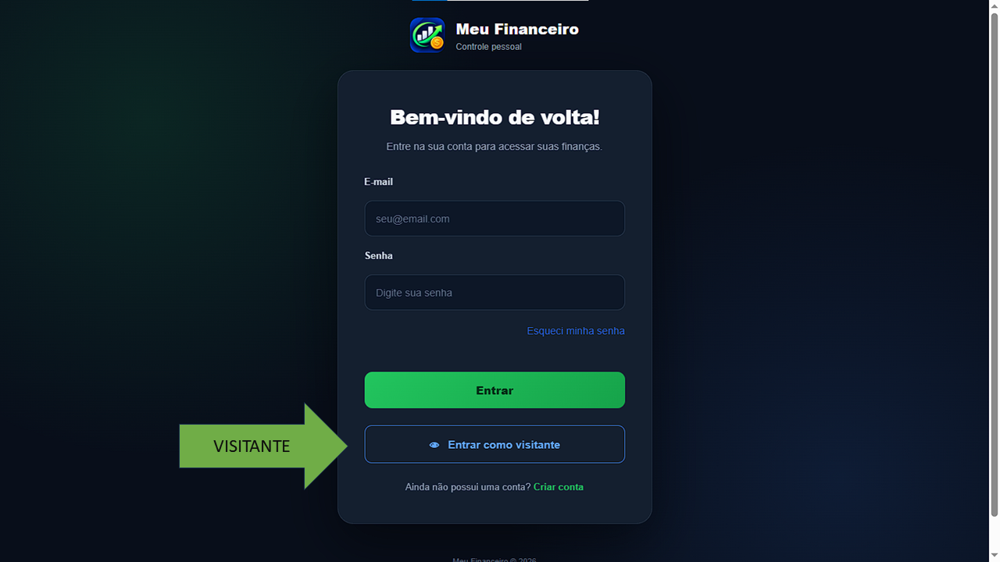
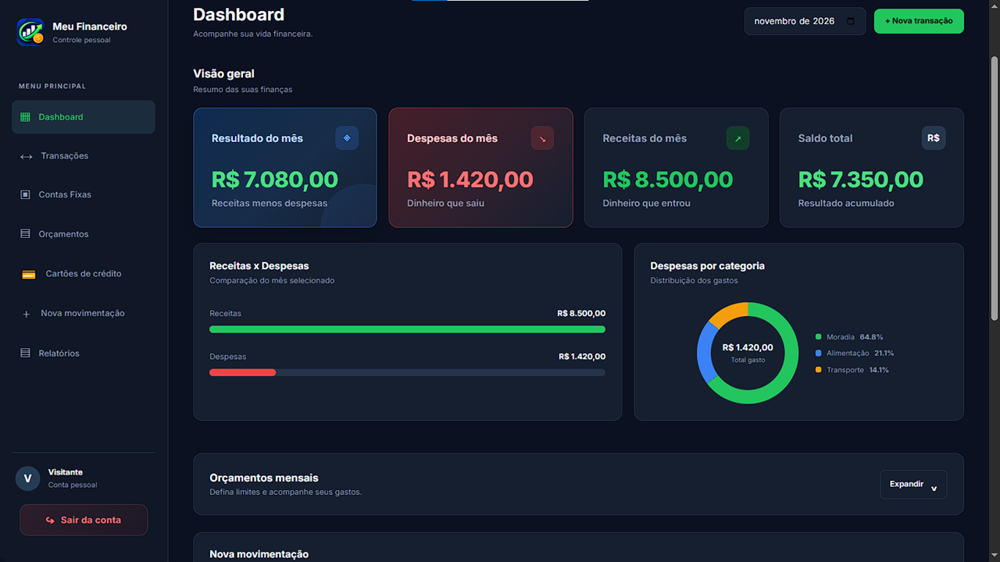
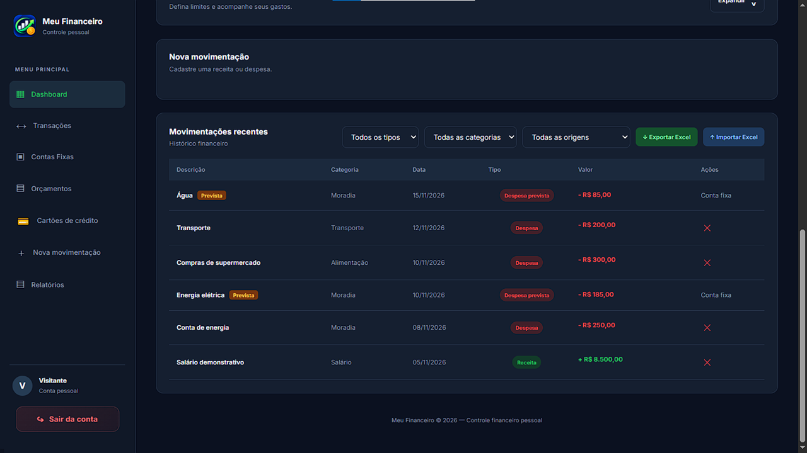
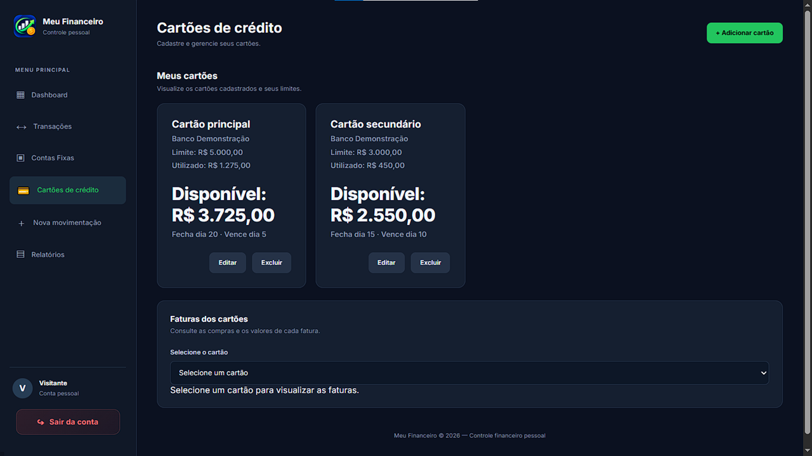
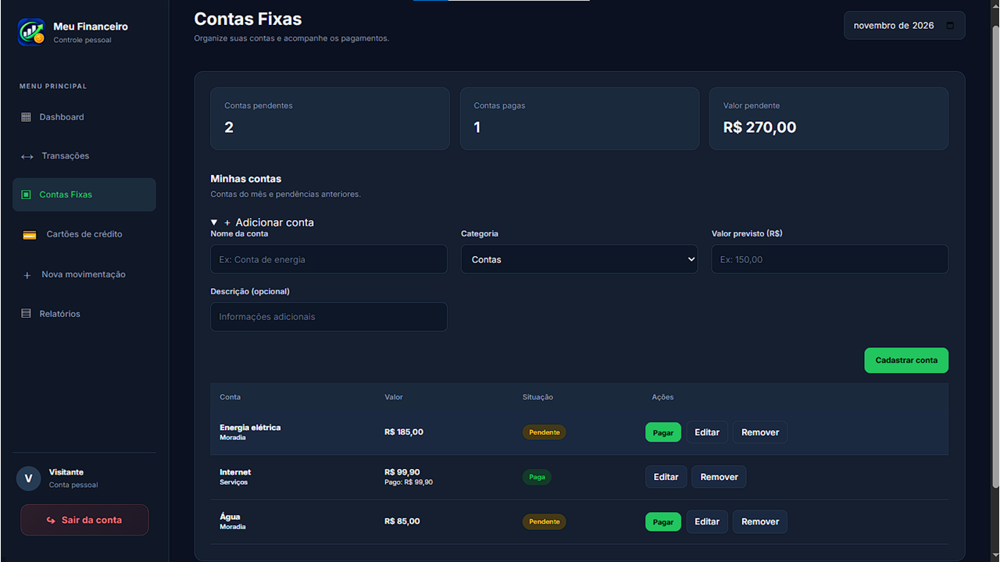
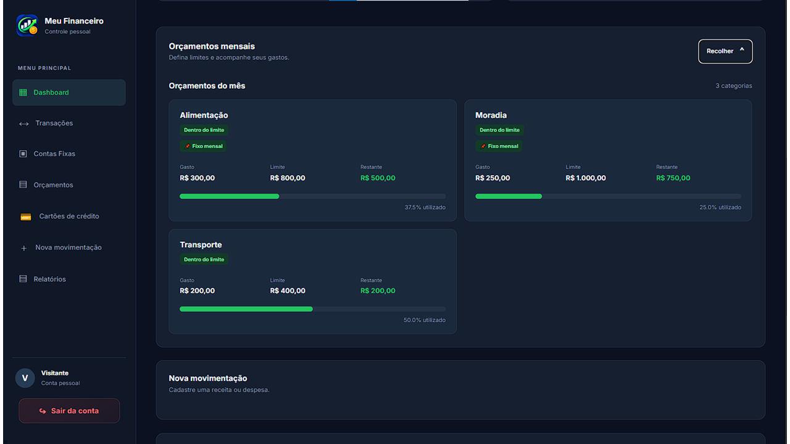
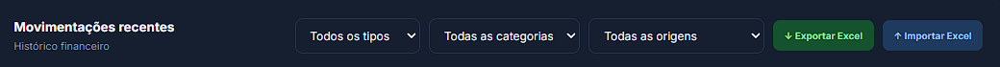

# 💰 Meu Financeiro

**Meu Financeiro** é uma aplicação web desenvolvida para facilitar a organização e o controle das finanças pessoais. O sistema permite registrar receitas e despesas, acompanhar o saldo, gerenciar cartões de crédito, controlar compras parceladas, organizar contas mensais e definir orçamentos.

O projeto foi desenvolvido com Python e FastAPI no backend, utilizando HTML, CSS e JavaScript no frontend.

🌐 **Acesse o sistema:** [Clique aqui para acessar](https://sistema-financeiro-tj76.onrender.com/)

---

# 📸 Demonstração do sistema

## 1. Tela de login


## 2. Modo visitante



## 3. Dashboard principal



## 4. Cadastro de movimentações



## 5. Cartões de crédito



## 6. Contas mensais



## 7. Orçamentos



## 8. Recurso adicional



# 🚀 Funcionalidades

## 🔐 Autenticação e gerenciamento de usuários

- Login com e-mail e senha.
- Cadastro de novos usuários.
- Recuperação de senha.
- Autenticação utilizando tokens JWT.
- Armazenamento da sessão no navegador.
- Encerramento da sessão.
- Proteção de rotas e operações autenticadas.

## 👁️ Modo visitante

O sistema possui um modo de demonstração que permite acessar a aplicação sem criar uma conta.

Características:

- Acesso por meio de um token específico para visitantes.
- Utilização de dados fictícios.
- Separação entre dados demonstrativos e dados reais.
- Bloqueio de operações de escrita para visitantes.
- Acesso às funcionalidades de consulta disponibilizadas para demonstração.

## 📊 Dashboard financeiro

O painel principal apresenta informações importantes para o acompanhamento financeiro:

- Total de receitas.
- Total de despesas.
- Saldo mensal.
- Saldo acumulado.
- Despesas agrupadas por categoria.
- Movimentações recentes.
- Consulta de informações por período.

## 💵 Receitas e despesas

O sistema permite cadastrar e administrar movimentações financeiras.

Cada movimentação pode conter:

- Descrição.
- Tipo de movimentação.
- Categoria.
- Valor.
- Data.

Também é possível:

- Consultar movimentações.
- Filtrar por mês.
- Filtrar por tipo.
- Editar registros.
- Excluir registros.
- Visualizar os resultados no dashboard.

Os valores monetários são armazenados em centavos no backend, reduzindo problemas de precisão em cálculos financeiros.

## 💳 Cartões de crédito

O módulo de cartões permite organizar compras realizadas utilizando crédito.

Funcionalidades:

- Cadastro e gerenciamento de cartões.
- Definição do limite.
- Configuração do dia de fechamento.
- Configuração do dia de vencimento.
- Registro de compras.
- Compras parceladas.
- Distribuição das parcelas entre as faturas.
- Consulta das faturas.
- Controle do limite utilizado.

O sistema trabalha com valores em centavos para realizar a divisão das parcelas, garantindo que a soma das parcelas corresponda ao valor original da compra.

## 🧾 Contas mensais

O módulo de contas mensais permite organizar compromissos financeiros recorrentes.

A proposta é facilitar o acompanhamento de despesas como:

- Água.
- Energia elétrica.
- Internet.
- Aluguel.
- Outras despesas mensais.

## 🎯 Orçamentos

O sistema permite definir limites de gastos por categoria.

Funcionalidades:

- Cadastro de orçamentos.
- Definição de limites financeiros.
- Consulta por mês.
- Agrupamento de gastos por categoria.
- Cálculo do valor utilizado.
- Cálculo do percentual consumido.
- Configuração de orçamentos fixos, conforme as regras disponíveis no sistema.

## 📁 Importação e exportação de Excel

A aplicação possui suporte para arquivos Excel no formato `.xlsx`.

### Exportação

Permite gerar uma planilha com as movimentações financeiras, incluindo:

- Descrição.
- Tipo.
- Categoria.
- Valor.
- Data.

A planilha recebe formatação de cabeçalho, filtros e formatos adequados para valores monetários e datas.

### Importação

Permite importar movimentações por meio de uma planilha Excel.

O sistema realiza validações para verificar:

- Existência das colunas obrigatórias.
- Descrição.
- Tipo da movimentação.
- Categoria.
- Valor.
- Data.

Caso sejam encontrados dados inválidos, a importação é interrompida e uma mensagem informa o problema encontrado.

---

# 🛠️ Tecnologias utilizadas

## Backend

| Tecnologia | Utilização |
|---|---|
| Python | Linguagem principal do backend |
| FastAPI | Desenvolvimento da API |
| SQLAlchemy | Mapeamento e comunicação com o banco de dados |
| Pydantic | Validação e estruturação de dados |
| SQLite | Banco de dados do ambiente local |
| OpenPyXL | Manipulação de planilhas Excel |
| JWT | Autenticação por tokens |

## Frontend

| Tecnologia | Utilização |
|---|---|
| HTML5 | Estrutura das páginas |
| CSS3 | Estilização e responsividade |
| JavaScript | Interatividade e comunicação com a API |
| Lucide Icons | Ícones da interface, quando utilizados |
| Google Fonts | Tipografia Inter |

## Ferramentas complementares

- Git.
- GitHub.
- Uvicorn.
- Visual Studio Code.
- Variáveis de ambiente.

---

# 🧠 Utilização de inteligência artificial

Durante o desenvolvimento do Meu Financeiro, utilizei inteligência artificial como ferramenta de apoio, principalmente na construção e no aprimoramento do frontend.

A ferramenta utilizada foi o **ChatGPT**.

A inteligência artificial auxiliou em atividades como:

- Criação e organização de estruturas HTML.
- Desenvolvimento e ajustes de CSS.
- Construção de elementos visuais.
- Melhorias na organização das páginas.
- Ajustes de responsividade.
- Sugestões de interface e experiência do usuário.
- Identificação e correção de erros.
- Apoio na organização do código.

A utilização da inteligência artificial teve como objetivo auxiliar o processo de desenvolvimento e aprendizagem.

As sugestões geradas foram analisadas, adaptadas e testadas de acordo com as necessidades do projeto.

A IA foi utilizada como ferramenta de apoio, e não como substituta do desenvolvimento, da análise ou da validação do sistema.

O projeto também envolveu a implementação e integração do frontend com o backend, organização das rotas, tratamento de dados, regras de negócio e testes de funcionamento.

---

# 🏗️ Arquitetura do projeto

O sistema utiliza uma arquitetura dividida em três partes principais:

```text
                 USUÁRIO
                    |
                    |
                 FRONTEND
             HTML / CSS / JS
                    |
                    |
              REQUISIÇÕES HTTP
                    |
                    |
                 BACKEND
                  FASTAPI
                    |
                    |
             SQLALCHEMY / ORM
                    |
                    |
                BANCO DE
                  DADOS
```

### Funcionamento

1. O usuário interage com a interface.
2. O JavaScript envia uma requisição para a API.
3. O FastAPI recebe e processa a requisição.
4. Os dados são validados.
5. O SQLAlchemy realiza as operações necessárias.
6. O backend retorna uma resposta.
7. O frontend atualiza as informações exibidas.

---

# 📂 Organização do projeto

A estrutura geral do projeto está organizada entre backend, frontend e documentação.

```text
sistema-financeiro/
│
├── backend/
│   ├── main.py
│   ├── auth.py
│   ├── models.py
│   ├── schemas.py
│   ├── database.py
│   ├── demo_data.py
│   └── routers/
│       └── transacoes.py
│
├── frontend/
│   ├── login.html
│   ├── cadastro.html
│   ├── dashboard.html
│   ├── css/
│   └── js/
│       └── auth.js
│
├── docs/
│   └── imagens/
│       ├── cadastro de movimentação.png
│       ├── cartões de crédito.png
│       ├── contas mensais.png
│       ├── promover.png
│       ├── orçamento.png
│       ├── tela de login.png
│       ├── tela principal.png
│       └── visitante.png
│
├── README.md
└── requirements.txt
```

*Observação: a estrutura acima é ilustrativa. Alguns nomes e arquivos podem variar conforme a organização atual do repositório.*

---

# ⚙️ Como executar o projeto localmente

## 1. Pré-requisitos

Antes de executar o projeto, é necessário ter:

- Python instalado.
- Git instalado.
- Visual Studio Code ou outro editor de código.
- Navegador atualizado.

## 2. Clonar o repositório

```bash
git clone URL_DO_REPOSITORIO
```

Entre na pasta do projeto:

```bash
cd sistema-financeiro
```

Substitua `URL_DO_REPOSITORIO` pelo endereço real do repositório.

## 3. Criar ambiente virtual

No Windows:

```bash
python -m venv venv
```

Ative o ambiente:

```bash
venv\Scripts\activate
```

## 4. Instalar dependências

```bash
pip install -r requirements.txt
```

## 5. Configurar variáveis de ambiente

Crie um arquivo `.env` com as variáveis necessárias para o funcionamento do backend.

Exemplo:

```env
SECRET_KEY=SUA_CHAVE_SECRETA
DATABASE_URL=sqlite:///./financeiro.db
```

Os valores devem corresponder à configuração utilizada no código.

**Importante:** nunca publique senhas, tokens ou chaves secretas no GitHub.

## 6. Iniciar o servidor

Na pasta do backend, execute:

```bash
uvicorn main:app --reload
```

A aplicação poderá ser acessada em:

```text
http://127.0.0.1:8000
```

A documentação interativa da API estará disponível em:

```text
http://127.0.0.1:8000/docs
```

---

# 🔌 API

O backend disponibiliza endpoints para comunicação com o frontend.

Entre os principais grupos estão:

| Rota | Finalidade |
|---|---|
| `/api/auth` | Autenticação e gerenciamento de usuários |
| `/api/transacoes` | Movimentações financeiras |
| `/api/movimentos` | Consulta de movimentações |
| `/api/dashboard` | Resumo financeiro |
| `/api/orcamentos` | Gerenciamento de orçamentos |
| `/api/planilhas` | Importação e exportação de Excel |

Para consultar todos os endpoints disponíveis, acesse a documentação automática do FastAPI em `/docs`.

---

# 🔒 Segurança

Como a aplicação trabalha com informações financeiras, alguns cuidados são importantes:

- Autenticação por tokens.
- Proteção de operações que exigem usuário autenticado.
- Validação dos dados recebidos pelo backend.
- Separação dos dados demonstrativos.
- Verificação de propriedade dos registros.
- Proteção de informações sensíveis por variáveis de ambiente.
- Utilização de HTTPS em ambientes publicados.
- Cuidados com backups do banco de dados.

O modo visitante utiliza dados fictícios e não deve ter acesso às operações de alteração dos dados de usuários reais.

---

# 🧪 Testes recomendados

Os principais fluxos que devem ser verificados são:

- [ ] Cadastro de usuário.
- [ ] Login.
- [ ] Encerramento de sessão.
- [ ] Recuperação de senha.
- [ ] Acesso como visitante.
- [ ] Consulta dos dados demonstrativos.
- [ ] Bloqueio de alterações no modo visitante.
- [ ] Cadastro de receitas.
- [ ] Cadastro de despesas.
- [ ] Edição de movimentações.
- [ ] Exclusão de movimentações.
- [ ] Filtros por mês e tipo.
- [ ] Cálculos do dashboard.
- [ ] Cadastro de cartões.
- [ ] Registro de compras parceladas.
- [ ] Consulta de faturas.
- [ ] Contas mensais.
- [ ] Cadastro de orçamentos.
- [ ] Importação de planilhas.
- [ ] Exportação de planilhas.
- [ ] Responsividade em dispositivos menores.

---

# 🚀 Melhorias futuras

O projeto poderá receber novas funcionalidades e melhorias, como:

- Relatórios financeiros avançados.
- Gráficos comparativos entre meses.
- Metas de economia.
- Notificações de vencimentos.
- Melhorias na experiência mobile.
- Testes automatizados.
- Histórico de alterações.
- Melhorias de acessibilidade.
- Sistema de backup e restauração.
- Novos recursos de análise financeira.

---

# 👨‍💻 Sobre o projeto

**Nome:** Meu Financeiro  
**Categoria:** Aplicação web de controle financeiro pessoal  
**Backend:** Python e FastAPI  
**Frontend:** HTML, CSS e JavaScript  
**Banco de dados:** SQLite no ambiente local, conforme configuração  
**Inteligência artificial:** ChatGPT, utilizado como apoio principalmente no desenvolvimento do frontend  
**Ano:** 2026

---

# 📌 Considerações finais

O Meu Financeiro é um projeto desenvolvido com o objetivo de aplicar conhecimentos de programação, desenvolvimento web, construção de APIs, banco de dados, autenticação e criação de interfaces.

Além de oferecer ferramentas para organização financeira, o projeto representa uma oportunidade de aprendizado prático sobre a integração entre frontend, backend e banco de dados.

O desenvolvimento também envolveu a utilização de ferramentas de inteligência artificial como apoio, com análise, adaptação e validação das soluções implementadas.

**Obrigado por conhecer o Meu Financeiro!**
